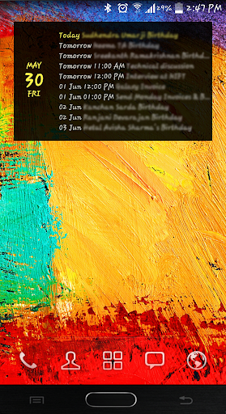
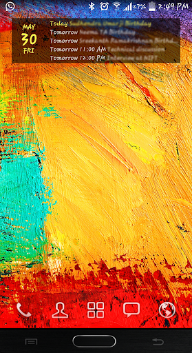
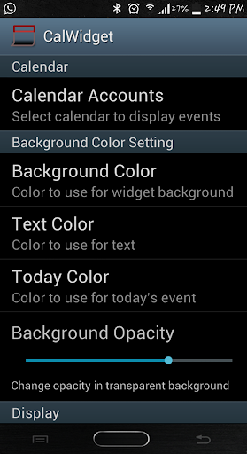
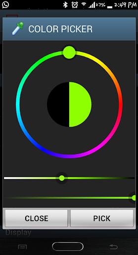

# Old app reference (from screenshots)

Source: 4 screenshots supplied by the user from `~/Downloads/simple calendar widget/`,
copied into `docs/reference-screenshots/` for durable reference (the Downloads copy
can be deleted/moved without losing them). These are the only ground truth we have
for the original app's actual design — nothing here should be invented beyond what's
visible, so gaps are called out explicitly rather than guessed.

This supersedes the UI/feature assumptions in `00-OVERVIEW.md` and
`01-ARCHITECTURE.md` written before these screenshots were available. Those docs
still describe what's *currently implemented*; this doc describes what the old app
actually looked like and what needs to change to match it. Reconciliation is listed
at the bottom.

## Old app description (provided by the user, 2026-11-13)

Verbatim, likely the Play Store listing's own description text:

> Calendar Widget is a simple and user friendly widget to provide information about
> each events.
> Can be easily customize on color, size, number of upcoming events.
> Supports all type of calendars such as Google Calendar, Facebook and Other Social
> Provider Calendars etc.
> Customize background color and round edges.

This confirms and extends the screenshot analysis below:

- **"Supports all type of calendars... Google Calendar, Facebook and Other Social
  Provider Calendars"** — confirms the widget isn't Google-Calendar-specific. On
  Android this is naturally satisfied by querying `CalendarContract` (the shared
  provider every sync adapter, including the old Facebook sync adapter, writes
  into) rather than any Google-specific API — which is what `CalendarRepository`
  already does. The "Calendar Accounts" picker (screenshot 3) is the UI for
  choosing *which* of those synced calendars to show, not a restriction on which
  providers are supported.
- **"customize on color, size, number of upcoming events"** — three separate
  customization axes:
  - **color** → the Background/Text/Today color pickers already seen in
    screenshot 3.
  - **number of upcoming events** → a setting controlling how many events are
    fetched/shown, likely in the cut-off **Display** section — not just whatever
    fits in the resized widget. (It's unclear from this phrase alone whether the
    old app's lookahead was "next N events" rather than "next 7 days" — see
    updated Open Questions.)
  - **size** → most likely **text/font size** (paired with "number of upcoming
    events" in the same sentence, both being Display-section-style settings),
    rather than the widget's home-screen resize (which is standard Android
    behavior, not something the app needs to "support" as a feature). Could
    plausibly be both.
- **"Customize background color and round edges"** — confirms a **corner-radius /
  rounded-edges** setting exists, almost certainly also in the Display section.
  This explains part of what's hidden in that cut-off section of screenshot 3.

## What the old app actually was

The in-app settings screen's title bar reads **"CalWidget"** (`03-settings-screen.png`)
— likely the internal app/activity label, distinct from the Play Store listing name
"Simple Calendar Widget". The app's entire purpose, based on these screens, is
**configuring a home-screen widget that lists upcoming calendar events** — a
widget-first app, not an app with its own main event-list screen. There is no
evidence in these screenshots of in-app notifications (no notification-settings UI
visible) — see "Open questions" below.

## Screenshot 1 & 2: the widget itself

Files: `01-widget-tall-10-events.png`, `02-widget-short-4-events.png`




Layout, left to right:

- **Date block** (fixed width, left side): large day-of-month number ("30"), month
  abbreviation above it ("MAY"), day-of-week abbreviation below it ("FRI"). Rendered
  in a warm yellow/orange, bold. This is "today's" date, not per-event — it stays
  fixed while the event list on the right scrolls.
- **Event list** (right side, takes remaining width): one line per event, vertically
  stacked, in a smaller font than the date block. Visible rows (screenshot 1):

  ```
  Today Sudhendra Umesh Birthday
  Tomorrow Veena TA Birthday
  Tomorrow Sreekanth Ramakrishnan Birthd...
  Tomorrow 11:00 AM Technical discussion
  Tomorrow 12:00 PM Interview at NEFT
  01 Jun 12:00 PM Family Doctor
  01 Jun 01:00 PM Amit Pandey Invoice & B...
  02 Jun Kanchan Sarda Birthday
  02 Jun Ranjani Basrajan Birthday
  03 Jun Hetal Anita Sharma's Birthday
  ```

  Date label logic inferred from this:
  - `Today` / `Tomorrow` for the next two days, then `DD MMM` (e.g. `01 Jun`) beyond
    that — not a raw weekday or full date.
  - **All-day events** (birthdays) show only the date label, no time.
  - **Timed events** show the date label *and* a time (`11:00 AM`, `12:00 PM`),
    12-hour format with AM/PM.
  - Long titles are truncated with an ellipsis rather than wrapping (single-line
    rows).
  - Multiple events on the same day each get their own row (02 Jun appears twice).

- **Background**: a semi-transparent dark (near-black) rounded rectangle, letting the
  home screen wallpaper show through at the edges — this is the "Background
  Opacity" setting from the config screen. Text sits directly on top, no card/shadow
  per-row.
- **Widget is resizable**: screenshot 1 shows a taller widget (10 rows visible,
  more of the screen covered); screenshot 2 shows a shorter one (4 rows: Today +
  3 Tomorrow entries), same width, clearly the standard Android widget resize handles
  being used — list scrolls/clips rather than reflowing.
- Rest of the screen (status bar icons, dialer/contacts/apps/messages/browser dock)
  is just the device home screen underneath, not part of the app.

## Screenshot 3: settings/configuration screen

File: `03-settings-screen.png`



A standard Android settings-style list (section headers + preference rows), app bar
titled "CalWidget" with a small red calendar icon. Visible sections/rows top to
bottom:

- **Calendar**
  - **Calendar Accounts** — "Select calendar to display events". This is a
    **calendar picker**: the user explicitly chooses which calendar(s) feed the
    widget, rather than the widget automatically aggregating every calendar on the
    device (contrast with the current implementation's "all calendars" approach —
    see Reconciliation below).
- **Background Color Setting**
  - **Background Color** — "Color to use for widget background"
  - **Text Color** — "Color to use for text"
  - **Today Color** — "Color to use for today's event" (implies "today's" row(s)
    are rendered in a distinct, user-chosen color from the rest of the list)
  - **Background Opacity** — a slider, "Change opacity in transparent background"
- **Display** — section header visible, but the screenshot is cropped right at this
  header with no rows shown. **Unknown what settings live here.** (see Open
  questions)

This is a dedicated **AppWidgetConfigureActivity** — standard Android pattern:
launched automatically the first time the widget is dropped onto the home screen,
also presumably re-openable later to change settings for an existing widget
instance.

## Screenshot 4: color picker dialog

File: `04-color-picker-dialog.png`



Appears when tapping Background Color / Text Color / Today Color. Components:

- Title bar: "🎨 COLOR PICKER"
- A **hue ring** (full color wheel) with a draggable handle
- A **saturation/value disc** in the middle, split half-black/half-selected-hue,
  with a draggable point for picking the exact shade
- A **brightness/lightness slider** (gradient bar, white → chosen hue)
- A second **gradient slider** that looks like an **alpha/opacity slider** (given
  the widget's own separate "Background Opacity" setting exists elsewhere, this one
  is more likely lightness or saturation than alpha — ambiguous from a still image)
- **CLOSE** and **PICK** buttons

This matches the common third-party `ColorPickerView`-style widget (e.g.
`danielnilsson9/color-picker-view` or similar HSV wheel pickers), not a stock
Android/AndroidX component — stock Android has no built-in HSV wheel+disc color
picker. Will need an equivalent library or a custom-built one.

## Reconciliation with the current implementation

The app built so far (`MainActivity` + `SimpleCalendarWidgetProvider`, see
`01-ARCHITECTURE.md`) is a reasonable *first cut* at the feature from the original
text description, but these screenshots show the real app is more specific and more
configurable than that. Concretely, still to design/build to match:

| Area | Current implementation | What the screenshots + description show | Gap |
|---|---|---|---|
| Calendar source | **Implemented 2026-11-16**: `CalendarRepository.getAvailableCalendars()` lists every calendar on the device; `WidgetConfigureActivity`'s "Calendar Accounts" section lets the user check/uncheck which ones feed each widget instance, stored per `appWidgetId` in `WidgetCalendarSelectionPrefs` | Any synced provider (Google, Facebook, other social calendars) via `CalendarContract`, with a picker for which ones feed the widget | Done |
| Widget layout | **Implemented 2026-11-16**: `FrameLayout` with a rendered-bitmap rounded background, a fixed date block (day/month/weekday), and a `RemoteViewsService`-backed `ListView` for the event rows | Fixed date block (big day/month/weekday) + separate scrolling event list, distinct styling | Done |
| Date labels | **Implemented 2026-11-16**: `EventLineFormatter` — `Today`/`Tomorrow`/`DD MMM`, time only on non-all-day events | `Today` / `Tomorrow` / `DD MMM`, time only when not all-day | Done |
| Colors | **Implemented 2026-11-16**: background/text/"today" colors + background opacity, per widget instance, via `WidgetConfigureActivity` + a custom HSV `ColorPickerDialog`, persisted in `WidgetAppearancePrefs` keyed by `appWidgetId` | User-configurable: background color, text color, "today" color, background opacity | Done. Picker matches the old hue ring + old/new disc (2026-11-24); see the color-picker section below |
| Corner radius | **Implemented 2026-11-16**: a 0–32dp slider in `WidgetConfigureActivity`, rendered into the same background bitmap as the fill color | "Customize... round edges" — configurable rounded corners | Done |
| Number of events shown | **Implemented 2026-11-13**: user picks either "N days ahead" or "N upcoming events" in `MainActivity`'s lookahead panel, persisted via `LookaheadPreferences` and shared by the worker, widget, and in-app list | "Customize... number of upcoming events" | Still app-global, not per-widget — see "Design choice" note below |
| Text size | **Implemented 2026-11-16**: a 10–22sp slider in `WidgetConfigureActivity`, applied to each event row via `RemoteViews.setTextViewTextSize` | "Customize... size" — likely font/text size | Done. Only applies to the event-list rows, not the date block's fixed sizes (12/28/12sp) |
| Config screen | **Implemented 2026-11-16**: `WidgetConfigureActivity`, launched automatically when the widget is placed (and reachable later via "Edit widget") | Dedicated settings screen, standard Android preference-list style | Done — it's a Compose form rather than the old app's Android-Settings-style preference list, same settings, different visual chrome |
| Notifications | Implemented (daily check, default sound) | Not visible in any screenshot or in the description | Likely still wanted per the original request, but doesn't appear to have existed in the old app itself — see Open Questions |

As of 2026-11-16, every row in this table beyond Notifications is implemented.
Notifications remain a deliberate addition beyond what the screenshots/description
confirm the old app had — see Open Questions.

### Design choice: per-widget appearance and calendar selection, app-global lookahead

`WidgetAppearance` (colors, opacity, corner radius, text size) and the calendar
selection (`WidgetCalendarSelectionPrefs`) are both stored **per `appWidgetId`** —
standard Android widget-configuration semantics, and the only way two different
widgets placed on the same home screen can show different calendars or colors.
`LookaheadSettings` (days vs. count) stays **app-global**, unchanged from the
2026-11-13 decision, because it also drives notifications and the in-app list, not
just one widget instance — there's no sane per-widget notification schedule. If a
future screenshot shows the old app's "Display" section was actually per-widget for
this too, revisit; for now this is a deliberate simplification, not an oversight.

### Calendar selection: "no explicit choice" vs. "explicitly chose everything"

`WidgetCalendarSelectionPrefs.get()` returns `null` when the widget has never had an
explicit selection saved, and that `null` is treated as "every calendar" everywhere
it's read (`CalendarRepository.getUpcomingEvents(calendarIds = null)` applies no
filter). `WidgetConfigureActivity` preserves this distinction deliberately: if the
user leaves every checkbox checked and hits Save, it stores `null` (via
`WidgetCalendarSelectionPrefs.clear()`) rather than an explicit set containing every
calendar ID that happened to exist at that moment. Storing the literal "all IDs as
of today" would silently stop including any calendar account added to the device
afterward — the opposite of what "select calendar to display events" should mean
when the user never actually chose to exclude anything.

### The color picker: hue ring + old/new disc (matches the old app)

As of 2026-11-24 `ColorPickerDialog` (`widget/ColorPickerDialog.kt`) mirrors the old
app's picker (screenshot 4): a hue ring with a draggable handle, a center disc split
into the old color (left half) and the new color (right half), a saturation slider and
a brightness slider, CLOSE / PICK buttons, plus a row of quick-pick swatches and the
hex value. Built with Compose `Canvas`/`pointerInput`, no third-party library.

### Beyond the old app (2026-11-24 colorful redesign)

Added on top of what the screenshots show, to make the widget more colorful and
flexible:

- **Theme presets** (`WidgetThemePreset`: Classic, Sunset, Ocean, Forest, Berry,
  Candy, Light). One tap sets the background, gradient, text, today, tomorrow and
  date colors. Classic is the old app's look and stays the default.
- **Exact old colors (2026-11-25)**: taken from the Play Store APK of
  `com.mondaz.widgettest` (decompiled with jadx; defaults in
  `com/mondaz/getter/CalendarPreferenceValue.java`): background `#000000` at opacity
  `B2` (70 %), text `#CCFFFFFF`, "calendar" color `#FFAB00` for today's rows and the
  date block, tomorrow `#009ACD`. These are now `WidgetAppearance.DEFAULT` and the
  Classic theme, and the old app's separate **Tomorrow Color** setting is back.
  The old app's own corners were square by default; the new default keeps 16 dp.
- **Gradient background**: a second background color, drawn diagonally into the same
  rounded bitmap.
- **Date Color**: the big MAY / 30 / FRI block has its own color instead of reusing
  the text color. It also scales with Text Size.
- **Calendar color dots**: a dot in each event's calendar color (`Instances.DISPLAY_COLOR`)
  before the row. Can be turned off.
- **Show Date** toggle to hide the date block.
- **Row styling** like the old widget: bold date label, slightly dimmer title, and
  `hh:mm a` times (`01:00 PM`).
- **Live preview** pinned at the top of the settings screen, over a painted-wallpaper
  gradient, using the user's real events (or samples before calendar access).
- **Branding**: the launcher icon is the user-supplied tear-off calendar artwork
  (green "AUGUST" header, "08", 2026-11-24), stored at
  `res/drawable-nodpi/ic_launcher_art.png` and used as the adaptive-icon foreground
  through a 23% `<inset>` (so the whole page fits round masks) on a white background.
  `ic_launcher_monochrome.xml` is a simple calendar-page silhouette for Android 13+
  themed icons. The same 512x512 PNG is in `docs/playstore-icon-512.png` for the Play
  Console listing. The widget-picker entry is labelled "Upcoming events", has a
  description, and shows `layout/widget_preview.xml` (sample events on the Berry
  gradient) as its preview on Android 12+. Older Android versions show the app icon
  in the picker, since `previewImage` isn't set. The template `mipmap-*dpi` WebP
  icons were removed: with minSdk 26 only the adaptive icon is ever used.
- The settings screen uses the old app's sections (Calendar, Background Color Setting,
  Display) as colored section headers, and the app has its own warm colorful theme
  instead of wallpaper-based dynamic color.

### How "round edges" and background color are actually rendered

`RemoteViews` (what `AppWidgetProvider`/`RemoteViewsService` are restricted to) has
no API for an arbitrary-radius rounded background — no custom `Drawable` can be
attached at runtime, and `setInt(id, "setBackgroundColor", color)` only ever draws a
sharp rectangle. `SimpleCalendarWidgetProvider.roundedBackgroundBitmap()` works
around this by rendering the rounded, colored (alpha-adjusted per the opacity
setting) rectangle into a `Bitmap` with `Canvas.drawRoundRect()`, sized to roughly
match the widget's current dimensions (via `AppWidgetManager.getAppWidgetOptions()`),
then displaying that bitmap behind everything else via an `ImageView` with
`scaleType="fitXY"`. This is the standard workaround used by widget apps that need a
custom-shaped background; the known trade-off is that since the bitmap is generated
at roughly-widget-size rather than the exact final pixel size, resizing the widget
can make the corner radius look very slightly non-circular until the next refresh
redraws the bitmap at the new size.

This is now a meaningfully bigger app than the original "7-day notify" description:
a configurable widget (per-instance colors/opacity/corner-radius/text-size via a
config activity + color-picker dialog) rendered as a `RemoteViewsService`-backed
collection widget (date block + scrolling, individually-colored event rows) with a
rendered-bitmap rounded background.

### Resolved: count-based vs. day-based event limit (2026-11-13)

Rather than guess which one the old app used, the decision (per the user) is to
**support both and let the user choose**, since that's a superset of either
possible old behavior and directly matches the marketing copy's "customize... size,
number of upcoming events" line. Implemented as:

- `data/LookaheadSettings.kt` — `LookaheadMode` enum (`DAYS` / `COUNT`),
  `LookaheadSettings(mode, value)` data class (defaults: `DAYS`, 7 — matching the
  original 7-day request), and `LookaheadPreferences`, a `SharedPreferences`
  wrapper so the choice persists and is shared across the app.
- `data/CalendarRepository.kt` — `getUpcomingEvents(settings, fromMillis)` dispatches
  to either `getUpcomingEventsByDays` (unchanged — queries `[from, from+days]`
  directly) or the new `getUpcomingEventsByCount` (queries a widening time window,
  starting at 30 days and doubling up to a 365-day cap, until at least `count`
  events are found or the cap is hit, then takes the first `count`) — `Instances`
  requires an explicit end bound, so an "N events, no matter how far out" query has
  to search progressively rather than ask for an unbounded range.
- `MainActivity.kt` — a new `LookaheadSettingsPanel` composable: two `FilterChip`s
  to pick the mode, and a +/− stepper (clamped to `LookaheadSettings.MIN_VALUE`..`MAX_VALUE`,
  i.e. 1..60) for the value. Changing either immediately re-queries the on-screen
  list, persists the setting, and triggers an immediate `WorkManager` run so the
  widget and notifications pick it up without waiting for the next daily check.
- `work/CalendarCheckWorker.kt` and `widget/SimpleCalendarWidgetProvider.kt` both now
  read `LookaheadPreferences.get(context)` instead of a hardcoded 7-day window, so
  all three surfaces (list, notifications, widget) stay consistent with whatever the
  user picked.

This setting lives in `MainActivity`'s screen, not `WidgetConfigureActivity` (built
2026-11-16 for colors/opacity/corner-radius/text-size) — a deliberate split, not a
leftover gap; see "Design choice: per-widget appearance, app-global lookahead"
above for why.

## Open questions (need your input or more screenshots before implementing)

1. **"Display" section** (screenshot 3) is cut off. Number of upcoming events,
   text size, and corner radius are all now implemented (in `MainActivity` and
   `WidgetConfigureActivity` respectively — see Reconciliation above), based on the
   marketing description rather than seeing this section directly. Still don't
   know: exact labels/order/wording the old app used, whether each was a slider vs.
   a numeric picker vs. a toggle (ours are all sliders/steppers), or whether there
   are more settings in there beyond these three. A screenshot scrolled further
   down would remove the remaining guesswork and might prompt small UI tweaks (not
   logic changes).
2. **Notifications**: none of the screenshots or this description mention
   notifications at all. Was the original app's "notify" behavior (if any) just
   stock Android calendar notifications (since the widget merely reads the
   calendar, rather than this app sending its own), or did the old app have its own
   notification feature on a settings screen not yet captured? This determines
   whether the notification code already built is a genuine *added* feature beyond
   the original app, or needs to match some specific old behavior.
3. Any screenshot of the **widget picker entry** (the widget's name/preview as shown
   in Android's "Add widget" picker) or the **app's own launcher icon**, to match
   branding exactly?
4. Is there a **second widget size/variant**, or is resizing (tall vs short, per
   screenshots 1–2) the only size behavior? ("size" in the description is now
   implemented as text size, per-widget resizing was already standard Android
   behavior needing no extra code — but if the old app also had a distinct
   size *variant* beyond resizing, that's still unhandled.)
5. Tapping a row in the old widget — does it open the specific calendar event, the
   calendar app, or this app? Not observable from static screenshots. **Current
   behavior**: tapping anywhere on the widget (background or a row) opens this
   app's `MainActivity` — an assumed default, not a confirmed match to the old
   app. Revisit if you know it opened the calendar event/app instead.

As of 2026-11-16: every row in the Reconciliation table is implemented, including
the Calendar Accounts picker. There is no remaining unbuilt feature from the
screenshots or description. Open questions 2–5 remain purely informational — none
block further implementation, they'd just refine details (notification provenance,
branding, widget size variants, tap behavior) if ever answered.
