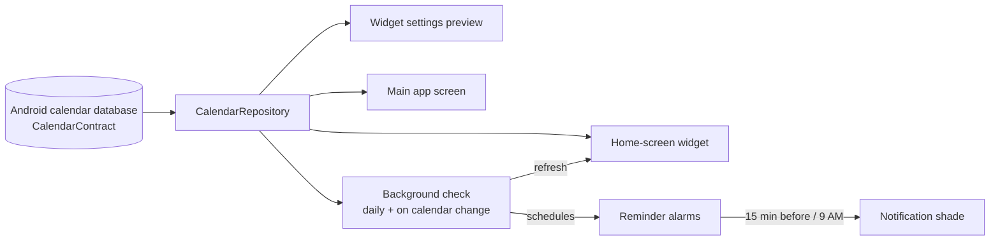
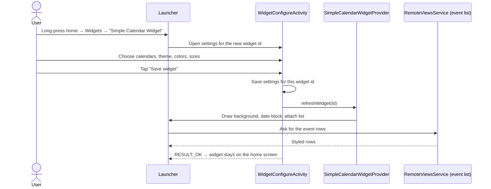
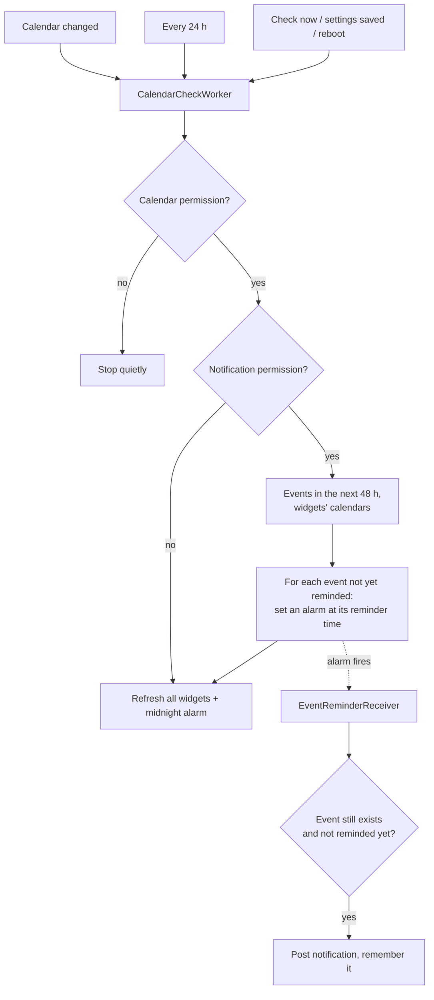

# Simple Calendar Widget — how the whole app works

This is the end-to-end flow of the app as built today (2026-11-24, after the gap fixes): what the user
sees, what runs in the background, and where each piece lives in the code. Package:
`in.versionx.calendarwidget` (all code paths below are under
`app/src/main/java/in/versionx/calendarwidget/`).

---

## 1. The big picture

The app has three things the user can touch, and one thing that runs on its own:

| Part | What it is | Code |
|---|---|---|
| **Home-screen widget** | The main product: big date on the left, scrolling list of upcoming events on the right | `widget/SimpleCalendarWidgetProvider.kt`, `widget/CalendarWidgetRemoteViewsService.kt` |
| **Widget settings screen** | Opens when a widget is added (or edited): pick calendars, theme, colors, sizes | `widget/WidgetConfigureActivity.kt` |
| **Main app screen** | Opened from the launcher icon: today's date, "how far ahead" setting, list of upcoming events | `MainActivity.kt` |
| **Background check** | Runs daily and within a minute of any calendar change: schedules event reminders and refreshes all widgets | `work/CalendarCheckWorker.kt` |

All of them read events from the same place — Android's shared calendar database
(`CalendarContract`) — through one class, `data/CalendarRepository.kt`. That's why it
works with Google Calendar, Samsung/Outlook/Facebook-synced calendars, and local
calendars alike: every calendar app on the phone writes into that same database.



---

## 2. First launch (opening the app from the launcher)

1. User taps the app icon (the green "AUGUST 08" calendar) → `MainActivity` opens.
2. **No calendar permission yet** → the screen shows the colorful header (today's
   date in an amber block) and a purple card: "Calendar access is needed…" with a
   **Grant permissions** button.
3. User taps **Grant permissions** → Android asks for `READ_CALENDAR`.
4. If allowed:
   - The event list loads immediately.
   - The **background check is scheduled** (`WorkScheduler.scheduleDailyCheck`): daily,
     plus a watcher that runs it whenever the calendar changes.
   - On Android 13+ the app then asks for `POST_NOTIFICATIONS` (needed for
     reminders only — the widget works without it).
5. If denied: nothing loads; the button stays until the user grants it.

Once permission is granted, every later launch goes straight to the full screen.

---

## 3. The main app screen

Top to bottom:

1. **Header** — orange/pink gradient with today's date in an amber block
   (`NOV / 24 / TUE`) and the full date.
2. **"Show upcoming events by" card** (coral)
   - Two chips: **Number of days** or **Number of events**.
   - A `−` / `+` stepper, 1 to 60 (e.g. "7 days ahead" or "10 upcoming events").
   - **Check now** button.
3. **"Add the widget" card** (blue) — short how-to.
4. **Upcoming events** — one card per event: a stripe and border in the event's
   calendar color, the title, the calendar's name, and a pill with the date label
   (`Today` in amber, otherwise `Tomorrow 11:00 AM` / `02 Jun` in the calendar color).
   The list uses **the same calendars as your widgets** (every calendar if no widget
   is placed, or if any widget shows all calendars); a small note says so when it's
   filtered.

**What the lookahead setting changes.** It is one app-wide setting
(`data/LookaheadSettings.kt`, saved in `LookaheadPreferences`) used by the main list
and every widget. Reminders don't use it: they always look 48 hours ahead (section 8).
Changing it:

1. saves it,
2. reloads the list on screen,
3. runs the background check once right away (`WorkScheduler.runOnce`), which
   refreshes all widgets and re-schedules reminders.

**Check now** does steps 2–3 without changing the setting.

How the two modes fetch events (`CalendarRepository.getUpcomingEvents`):

- **Days**: every event from now until N days ahead.
- **Events**: the next N events, however far away. Android's calendar query needs an
  end date, so it searches 30 days ahead, then 60, 120, 240, up to 365 days, stopping
  as soon as it has N events.

Each result is one *occurrence* (a weekly meeting shows up once per week), sorted by
start time, carrying its title, start/end, all-day flag, calendar name and color.

---

## 4. Adding a widget to the home screen



1. User long-presses the home screen → **Widgets** → finds **Simple Calendar
   Widget**. The picker shows the app icon, the label "Upcoming events", a one-line
   description, and a sample preview (purple-pink gradient, `MAY 30 FRI`, five
   sample events). That preview is a static layout, `res/layout/widget_preview.xml`.
2. User drags it onto the home screen (default 3 × 2 cells; resizable both ways).
3. Android immediately opens **`WidgetConfigureActivity`** for that new widget
   (declared as the widget's `configure` activity in
   `res/xml/simple_calendar_widget_info.xml`).
4. If the user presses **back** without saving, the widget is cancelled and removed.
   If they tap **Save widget**, it's kept.

Each widget on the home screen has its **own** settings (calendars, colors, sizes),
stored by its widget id. Two widgets can look completely different.

---

## 5. The widget settings screen

Laid out like the old app's settings, in colored sections. A **live preview** is
pinned at the top over a painted-wallpaper gradient — it updates instantly as
anything changes and shows the user's real events (or sample ones before calendar
access).

| Section | Setting | What it does |
|---|---|---|
| **Themes** | Classic, Sunset, Ocean, Forest, Berry, Candy, Light | One tap sets background (and gradient), text, today, tomorrow and date colors. Classic = the old app's exact colors (default): black at 70 %, text `#CCFFFFFF`, today and date `#FFAB00`, tomorrow `#009ACD`. |
| **Calendar** | Calendar Accounts | Checkbox per calendar on the phone, with its color dot and account name. Untick to hide it from this widget. Untick all and the widget shows "No upcoming events". |
| **Background Color Setting** | Background Color | Main background color |
| | Gradient Background (switch) | Fade the background diagonally into a second color |
| | Gradient Color | That second color (shown only when the switch is on) |
| | Text Color | Date labels and titles |
| | Today Color | Rows for today's events |
| | Tomorrow Color | Rows for tomorrow's events |
| | Date Color | The big MAY / 30 / FRI block |
| **Display** | Background Opacity | 0–100 % (how much wallpaper shows through) |
| | Round Edges | Corner radius 0–32 dp |
| | Text Size | 10–22 sp (the date block scales with it) |
| | Show Date (switch) | Show or hide the date block |
| | Calendar Color Dots (switch) | A dot in each event's calendar color before the row |

Tapping any color row opens the **color picker** (`widget/ColorPickerDialog.kt`),
modeled on the old app's:

- a **hue ring** — drag or tap to pick the hue;
- a **center circle split in two**: old color on the left, new color on the right;
- a **saturation** slider and a **brightness** slider;
- a row of **quick swatches** and the **hex code**;
- **CLOSE** (discard) and **PICK** (apply to the preview).

Nothing is saved until **Save widget**. Saving:

1. stores the appearance (`WidgetAppearancePrefs`) for this widget id;
2. stores the calendar choice (`WidgetCalendarSelectionPrefs`). If **every**
   calendar is ticked it stores "no filter" instead of the list, so calendars added
   to the phone later appear automatically;
3. redraws the widget straight away (`SimpleCalendarWidgetProvider.refreshWidget`),
4. runs the background check once, because reminders follow the widgets' calendars,
5. closes the screen.

To change settings later, use the launcher's **Edit widget / Settings** action on
the widget (it's marked `reconfigurable`), which reopens this same screen with the
saved values.

---

## 6. How the widget is drawn

Home-screen widgets can't run app code directly; the app sends the launcher a
description of the views (`RemoteViews`). Drawing happens in two parts.

**a) The frame** — `SimpleCalendarWidgetProvider.updateWidget()`, layout
`res/layout/widget_simple_calendar.xml`:

1. Reads this widget's appearance.
2. **Background**: widgets can't have a custom rounded/gradient background, so the
   app paints one into an image — a rounded rectangle at the widget's size, in the
   chosen color (or diagonal gradient) at the chosen opacity — and shows it behind
   everything.
3. **Date block**: today's month, day number and weekday in the Date Color, sized
   from Text Size (day number = 2.4 × text size). Hidden if Show Date is off.
4. **Empty text** "No upcoming events", shown only when the list is empty.
5. Hooks up the event list to the list service (below).
6. Tapping an **event row** opens that event in the phone's calendar app (via
   `OpenEventActivity`, an invisible hop — see section 8). Tapping anywhere else
   on the widget opens the main app.

**b) The event rows** — `CalendarWidgetRemoteViewsService` (an adapter the launcher
calls):

1. Loads events with the app-wide lookahead setting, filtered to this widget's
   chosen calendars (none ticked = no events).
2. For each event builds one single-line row (`EventLineFormatter.styledLine`):

   ```
   ●  Tomorrow 11:00 AM  Technical discussion
   │  └── bold label ─┘  └─ title, slightly dimmer ─┘
   └ calendar color dot (if enabled)
   ```

   - **Label**: `Today`, `Tomorrow`, or `02 Jun`; plus a time like `11:00 AM`
     for timed events. All-day events (birthdays) show no time.
   - **Colors**: today's rows use Today Color, tomorrow's rows Tomorrow Color, and
     later rows Text Color — as in the old widget. The title is the same color at
     ~85 % so the label stands out.
   - Long titles are cut with "…".
3. If calendar permission was removed, it shows an empty list instead of crashing.

All-day events are stored by Android at UTC midnight. The formatter reads them back
as a plain date so a birthday never shows up on the wrong day in time zones behind
UTC.

---

## 7. When does the widget update?

| Trigger | What happens |
|---|---|
| **Save widget** in settings | That widget redraws immediately |
| **Any calendar change** (event added, edited, deleted, synced) | Background check runs within ~10 s – 1 min → all widgets redraw |
| **Midnight** | A small alarm just after 00:00 redraws all widgets, so the date block and `Today` / `Tomorrow` labels move to the new day (`widget/MidnightRefresh.kt`). If the phone is asleep it fires when the phone wakes up. |
| **Clock or time-zone change** | Same redraw as midnight |
| **Daily background check** (every 24 h) | All widgets redraw (safety net) |
| **Check now** / changing the lookahead in the app | Runs the check once → all widgets redraw |
| Android's own widget timer (`updatePeriodMillis`, ~every 6 h) | Frame redraws |
| Widget resized | Next redraw uses the new size for the background image |

---

## 8. The background check and event reminders



**When the check runs** (`work/WorkScheduler.kt`):

- **On any calendar change**: a WorkManager job waits for a change anywhere in the
  phone's calendar database, runs about 10 seconds to 1 minute later, then re-arms
  itself.
- **Every 24 hours**, as a safety net.
- On **Check now**, changing the lookahead, or saving a widget's settings.
- **After a reboot** (`work/BootRescheduleReceiver.kt`): Android wipes alarms on
  restart, so the check runs once to re-create them.

**When reminders show** (`notification/ReminderTimes.kt`):

| Event | Reminder |
|---|---|
| Timed event (e.g. 11:00 AM meeting) | **15 minutes before** it starts (10:45 AM) |
| All-day event (birthday, holiday) | **9:00 AM** on that day |
| Reminder time already passed, but the meeting hasn't started / the all-day event's day isn't over | Right away |
| Meeting already started, or the all-day event's day is over | No reminder |

Each check sets alarms only for reminders due in the **next 48 hours**; later events
get theirs on a later check. So there's never a burst of notifications on the first
run.

**How a reminder is shown** (`notification/EventReminders.kt`):

1. The check sets one alarm per event occurrence; setting it again just replaces it.
   On Android 12+ without the exact-alarm permission, Android may deliver it up to
   10 minutes late (so a "15 minutes before" reminder arrives 5–15 minutes before).
2. When it fires, `EventReminderReceiver` checks the event **still exists at that
   time** (deleted or moved events are skipped; a moved event gets its own new alarm)
   and hasn't been shown already.
3. It posts the notification (`notification/NotificationHelper.kt`): channel "Event
   reminders", high importance, default sound, tinted in the calendar's color.
   Title = event name; text = `Today 11:00 AM · Work` (or `Today · Personal` for
   all-day). **Tapping it opens the event in the calendar app.**
4. `notification/NotifiedEventStore.kt` remembers it (event id + start time) so it's
   never shown twice. Entries are dropped once the event has started.

**Which calendars:** the same ones the widgets show, i.e. the union of every widget's
choice (`WidgetCalendarSelectionPrefs.appCalendarFilter`). With no widget placed,
all calendars.

**Opening an event** (`OpenEventActivity.kt`): widget rows and notifications point to
this invisible screen. It asks the phone's calendar app to show that event (with its
start/end time) and closes. If no calendar app can open it, the main app opens
instead.

---

## 9. Permissions

| Permission | Why | When asked |
|---|---|---|
| `READ_CALENDAR` | Read events for the list, widget and notifications | Main screen's **Grant permissions** button, or the settings screen's **Grant calendar permission** |
| `POST_NOTIFICATIONS` (Android 13+) | Show event reminders | Right after calendar access is granted in the main screen |
| `RECEIVE_BOOT_COMPLETED` | Re-create reminder alarms and the daily check after a reboot | Never asked — granted at install |

Reminder and midnight alarms need no permission: they use Android's normal, slightly
flexible alarms, not exact alarms.

The WorkManager library also adds `WAKE_LOCK`, `ACCESS_NETWORK_STATE` and
`FOREGROUND_SERVICE` to the final app automatically (none need asking). There is no
`INTERNET` permission. More detail: `docs/02-PERMISSIONS.md`.

---

## 10. Where things are saved

All on the phone, in the app's private storage (SharedPreferences). Nothing is sent
anywhere — the app has no internet permission.

| Saved data | File | Scope |
|---|---|---|
| Lookahead mode + number | `lookahead_settings` | Whole app |
| Colors, opacity, corners, text size, switches | `widget_appearance` (keys like `5_background`) | Per widget |
| Chosen calendars | `widget_calendar_selection` | Per widget |
| Already-reminded events | `notified_events` | Whole app |

When a widget is removed from the home screen, its appearance and calendar choice
are deleted (`SimpleCalendarWidgetProvider.onDeleted`).

---

## 11. App look and branding

- **Theme** (`ui/theme/`): the app's own warm palette (coral, amber, berry, sky,
  teal) in light and dark mode. It doesn't use Android 12's wallpaper-based colors,
  so it looks the same on every phone.
- **Widget picker preview**: Android 12+ draws `res/layout/widget_preview.xml`;
  Android 8–11 shows `res/drawable-nodpi/widget_preview_image.png`, a picture of that
  same layout. After changing the layout, regenerate the picture with the
  instrumented test `WidgetPreviewImageGenerator` (instructions are in the file).
- **Launcher icon**: the green "AUGUST 08" tear-off calendar on white
  (`res/drawable-nodpi/ic_launcher_art.png`, placed by
  `res/drawable/ic_launcher_foreground.xml`). Android 13+ themed icons use the
  single-color outline in `ic_launcher_monochrome.xml`.
- **Play Store icon**: `docs/playstore-icon-512.png`.

---

## 12. Code map

```
in/versionx/calendarwidget/
├── MainActivity.kt                    Main screen: header, lookahead card, event cards
├── OpenEventActivity.kt               Invisible hop: opens one event in the calendar app
├── data/
│   ├── CalendarRepository.kt          Reads calendars + event occurrences from the phone
│   ├── CalendarEvent.kt               One occurrence (title, times, all-day, color)
│   ├── CalendarInfo.kt                One calendar (name, account, color)
│   └── LookaheadSettings.kt           Days/Events mode + saving it
├── widget/
│   ├── SimpleCalendarWidgetProvider.kt   Draws the widget frame, background, date block
│   ├── CalendarWidgetRemoteViewsService.kt  Supplies the event rows
│   ├── EventLineFormatter.kt          "Today / Tomorrow 11:00 AM / 02 Jun" + row styling
│   ├── WidgetConfigureActivity.kt     Widget settings screen
│   ├── WidgetPreview.kt               Live preview used on the settings screen
│   ├── ColorPickerDialog.kt           Hue-ring color picker
│   ├── WidgetAppearance.kt            Per-widget style + the 7 theme presets
│   ├── WidgetAppearancePrefs.kt       Saves per-widget style
│   ├── WidgetCalendarSelectionPrefs.kt  Saves per-widget calendar choice (+ union for the app)
│   └── MidnightRefresh.kt             Redraws widgets after midnight / clock changes
├── work/
│   ├── WorkScheduler.kt               Daily check + "calendar changed" watcher + run once
│   ├── CalendarCheckWorker.kt         The check: schedule reminders + refresh widgets
│   └── BootRescheduleReceiver.kt      Re-creates alarms and work after reboot
├── notification/
│   ├── ReminderTimes.kt               When to remind (15 min before / 9 AM all-day)
│   ├── EventReminders.kt              Sets reminder alarms + receiver that shows them
│   ├── NotificationHelper.kt          Channel + posting a reminder
│   └── NotifiedEventStore.kt          Remembers what was already shown
└── ui/theme/                          Colors, theme, typography
```

---

## 13. Limits to know about

The six gaps listed in the first version of this document were fixed on 2026-11-24:
empty calendar selection, stale date after midnight, early/bulk notifications, the
calendar choice ignored by notifications and the main list, rows not opening the
event, and the missing picker preview on Android 8–11. What remains:

1. **Reminders can be up to 10 minutes late** on Android 12+, because the app uses
   normal alarms rather than asking for the exact-alarm permission.
2. **The reminder time is fixed** (15 minutes before; 9 AM for all-day events). It
   doesn't use each event's own reminder settings from the calendar app, and there's
   no setting to change it.
3. **The main screen list doesn't refresh by itself** when you come back to the app
   after changing a widget. Tap **Check now** or reopen the app.
4. **The midnight refresh waits for the phone to wake up** if it's asleep at
   midnight. That's by design, since nobody sees the widget while the screen is off.

Background on how the design maps to the old app's screenshots:
`docs/05-OLD-APP-REFERENCE.md`. Testing steps: `docs/04-TESTING.md`.
